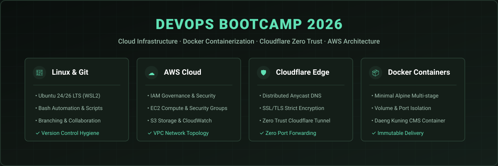

  

  <h1>DevOps Bootcamp 2026</h1>
  
<strong>Hands-on DevOps, Cloud Infrastructure, Docker Containerization & Cloudflare Edge Engineering</strong>

  

    
    
    
    
  

  

    
    
    
    
    
    
    
  

---

## 📌 Pengenalan & Objektif (Overview)

- **Functionality**: Hands-on DevOps engineering laboratory and production infrastructure curriculum spanning IAM governance, EC2/S3 cloud deployment, Cloudflare Zero Trust tunneling, and Docker containerization.
- **Aesthetic Value**: Highly structured, modular engineering documentation featuring reproducible configuration blueprints, network diagrams, and systematic execution logs.
- **Business Value**: Validates enterprise cloud infrastructure capabilities, immutable server architectures, and automated edge security protocols suitable for enterprise adoption.

Repositori ini merekodkan arkib pembelajaran praktikal, nota konfigurasi, dan eksperimen secara langsung (*hands-on lab*) sepanjang program **DevOps Bootcamp 2026**. Kurikulum ini merangkumi empat domain utama kejuruteraan infrastruktur:

1. **Git Foundations & Aliran Kerja Percabangan**: Menguasai asas kawalan versi Git secara praktikal — inisialisasi repositori, staging, commit conventions, analisis sejarah `git log`/`git diff`, pencabangan (*branching*), penggabungan (*merging*), penyelesaian konflik, dan Pull Requests.
2. **Pengkomputeran Awan AWS**: Pembinaan persekitaran awan bermula daripada pengurusan identiti IAM, persediaan mesin maya EC2, storan objek S3, dan pemantauan CloudWatch.
3. **Keselamatan Edge & Rangkaian Cloudflare**: Konfigurasi DNS teragih, SSL/TLS automatik, peraturan sekatan WAF, serta pembinaan gerbang akses selamat melalui Cloudflare Zero Trust dan Cloudflare Tunnel.
4. **Kontena Docker**: Asas kontena perisian, pengoptimuman imej berasaskan Alpine Linux, manipulasi volum dan port, serta pembangunan kontena CMS Daeng Kuning.

---

## 📚 Matriks Modul & Sukatan Latihan (Curriculum Matrix)

| Modul | Domain | Fokus Praktikal & Hasil Latihan | Direktori Nota |
|---|---|---|---|
| **Git 1 & 2** | Asas Kawalan Versi | Perintah asas (`init`, `add`, `commit`, `status`, `log`, `branch`, `switch`, `merge`, `push`, `pull`), etika komit, dan aliran kolaborasi. | [`notes.md`](notes.md) |
| **AWS 1** | Identiti & Keselamatan | Pengurusan pengguna AWS IAM, prinsip *least privilege*, pengesahan identiti STS, dan konfigurasi AWS CLI. | [`aws1/`](aws1/) |
| **AWS 2** | Pengkomputeran Maya | Pelancaran instans EC2, konfigurasi Kumpulan Keselamatan (*Security Groups*), penetapan SSH key pair, dan ujian sambungan. | [`aws2/`](aws2/) |
| **AWS 3** | Storan & Pemantauan | Pengurusan bucket S3, dasar capaian awam, metrik prestasi pelayan, dan penggera amaran CloudWatch. | [`aws3/`](aws3/) |
| **AWS 4** | Senibina Rangkaian | Persediaan VPC asas, Subnet Awam/Persendirian, Gateway Internet, dan jadual penghalaan (*Route Tables*). | [`aws4/`](aws4/) |
| **Cloudflare 1** | Domain & Penyulitan | Migrasi pelayan nama (DNS Nameservers), pengurusan rekod A/CNAME, penguatkuasaan HTTPS, dan tetapan cache edge. | [`cloudflare1/`](cloudflare1/) |
| **Cloudflare 2** | Zero Trust & Tunnel | Pembinaan Cloudflare Tunnel (`cloudflared`) untuk mendedahkan perkhidmatan tempatan secara selamat tanpa port forwarding. | [`cloudflare2/`](cloudflare2/) |
| **Docker 1** | Kontena Aplikasi | Penggunaan Docker Engine, analisis saiz imej (`alpine`, `nginx`, `cms-daeng-kuning`), pengasingan kontena, dan pemetaan port. | [`docker1/`](docker1/) |

---

## 🛠️ Stack & Alatan Kejuruteraan

- **Sistem Pengendalian**: Ubuntu 24.04 / 26.04 LTS (WSL2), Linux CLI
- **Shell**: Bash Scripting, systemd
- **Kontena**: Docker 29.8+, Dockerfile, Nginx Alpine
- **Awan & Rangkaian**: Amazon Web Services (AWS), Cloudflare WAF / Zero Trust / Tunnel
- **Kawalan Versi & CI**: Git, GitHub Actions, Conventional Commits

---

## 🛡️ Kebersihan Keselamatan (Security & Hygiene)

- Semua rahsia sebenar, kata laluan pangkalan data, dan kunci API dipisahkan dari kawalan versi melalui `.gitignore`.
- Templat contoh selamat disediakan dalam [`.env.example`](.env.example).
- Fail log sementara disekat daripada penjejakan git secara automatik.

---

## 🤝 Panduan Sumbangan

Sila rujuk [CONTRIBUTING.md](CONTRIBUTING.md) untuk panduan standard komit, etika pembukaan Pull Request, dan tatacara penamaan cawangan.

---

## 📄 Lesen

Copyright (c) 2026 Muhammad Syahmi ([syahmiaof](https://syahmiaof.my)). All rights reserved.  
Proprietary source code created solely for demonstration and portfolio showcase purposes.
